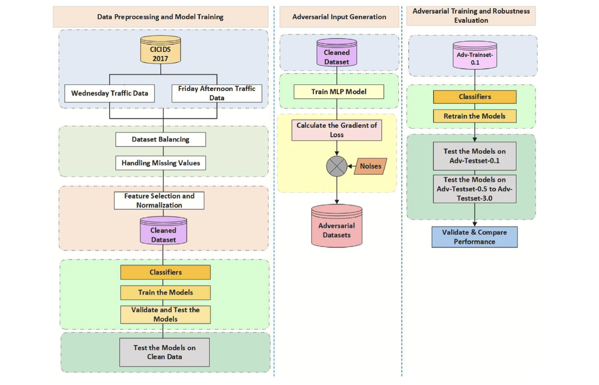
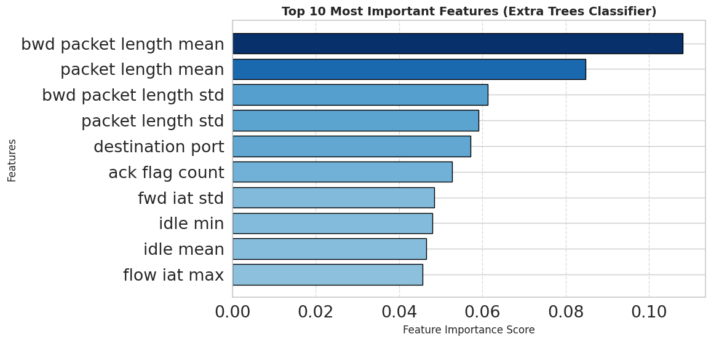
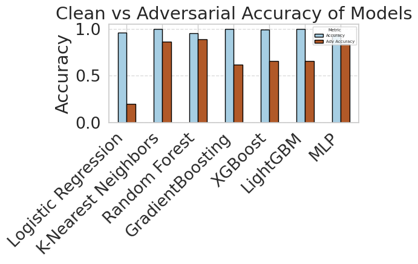
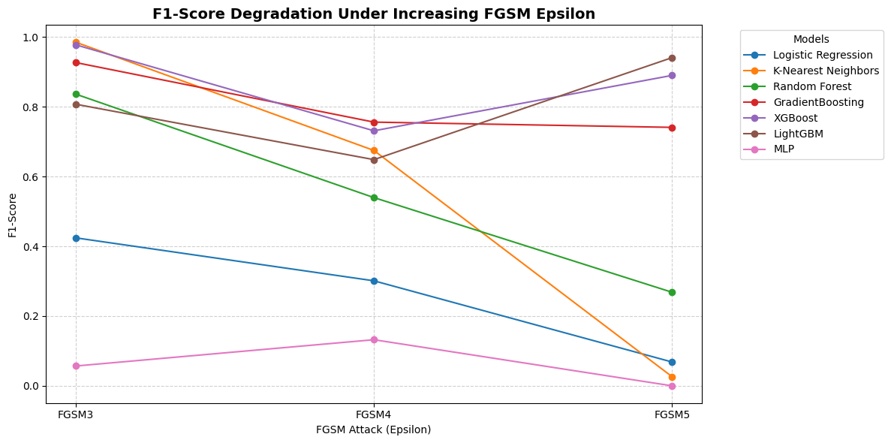

# Benchmarking the Adversarial Resilience of Machine Learning Models for DDoS Detection

**Peer-reviewed research | Array (Elsevier), Volume 29, Article 100664 (2026)**

**Authors:** Harsh Dadhwal, Mateus de Abreu, Nazanin Parvizi, Sajal Saha

**Publication:** [Read the paper](https://doi.org/10.1016/j.array.2025.100664)

## Overview

Machine learning models can achieve high accuracy in detecting malicious network traffic. But how reliable are these models when an attacker deliberately manipulates their inputs?

This research investigates the adversarial robustness of seven machine learning classifiers for Distributed Denial of Service (DDoS) detection. Using the CIC-IDS2017 dataset, we evaluated model performance under Fast Gradient Sign Method (FGSM) attacks and examined how adversarial training influences robustness across different perturbation strengths.

The study compares traditional classifiers, tree-based ensembles, and a neural network to understand their behavior under adversarial conditions.

## Research Objectives

- Benchmark seven machine learning models for network attack detection.
- Evaluate classification performance under FGSM adversarial perturbations.
- Investigate the effect of adversarial training on model robustness.
- Compare model resilience across multiple perturbation strengths.

## Experimental Methodology

*Figure 1. Experimental workflow of the published study. Source: Dadhwal et al., Array (2026).*

### 1. Dataset and Preprocessing

The experiments used the [CIC-IDS2017 dataset](https://www.unb.ca/cic/datasets/ids-2017.html), developed by the Canadian Institute for Cybersecurity.

Two traffic subsets were selected:

- Wednesday Working Hours
- Friday Working Hours — Afternoon DDoS

The preprocessing pipeline included duplicate removal, handling missing and infinite values, median imputation, and consolidation of attack labels into a binary classification task.

Feature reduction was performed using Pearson correlation analysis and Extra Trees feature importance ranking. The final classification experiments used ten selected input features.

*Figure 2. Ten selected features ranked using the Extra Trees Classifier.*

### 2. Machine Learning Models

Seven classifiers were evaluated:

| Category | Model |
|---|---|
| Linear | Logistic Regression |
| Instance-based | K-Nearest Neighbors |
| Bagging ensemble | Random Forest |
| Boosting ensemble | Gradient Boosting |
| Boosting ensemble | XGBoost |
| Boosting ensemble | LightGBM |
| Neural network | Multi-Layer Perceptron |

Models were initially trained on clean data to establish baseline classification performance.

### 3. Adversarial Attack Generation

We used the Fast Gradient Sign Method (FGSM) to generate adversarial perturbations.

An MLP surrogate model was used to compute input gradients, allowing adversarial examples to be generated and evaluated against the selected classifiers.

FGSM was chosen as a computationally efficient baseline for comparing robustness across different model architectures.

The study evaluated perturbation strengths of:

**ε = 0.1, 0.5, 1.0, and 3.0.**

### 4. Adversarial Training

Following the initial adversarial evaluation, models were retrained using an augmented dataset containing clean and FGSM-generated samples at ε = 0.1.

The retrained models were then evaluated under increasing perturbation strengths to examine changes in robustness under the experimental protocol.

## Experimental Results

### Clean vs. Adversarial Performance

*Figure 3. Comparison of model accuracy on clean and FGSM-perturbed samples in the initial evaluation.*

The experiments demonstrated that high classification performance on clean traffic does not necessarily translate into robustness against adversarial perturbations.

Different model architectures exhibited substantially different levels of sensitivity to FGSM-generated inputs.

### Robustness Across Perturbation Strengths

*Figure 4. F1-score comparison across the stronger FGSM perturbation levels evaluated in the study.*

Under the evaluated conditions, the published results showed that boosting-based ensemble models generally maintained stronger robustness than several alternative classifiers.

The experiments also revealed that robustness was not always monotonic as perturbation strength increased, highlighting the importance of evaluating models across multiple attack strengths rather than relying on a single adversarial setting.

### Key Findings

1. High accuracy on clean network traffic did not guarantee adversarial robustness.
2. FGSM perturbations produced substantial performance degradation in several classifiers.
3. The published experiments reported improved resilience following adversarial training under the evaluated setup.
4. Ensemble methods, particularly boosting-based classifiers, generally demonstrated stronger performance across the tested perturbation levels.
5. Model selection and adversarial evaluation are important considerations for ML-based intrusion detection.

For complete numerical results, see **Table 4 of the published article**.

## Scope and Limitations

The study focuses on the CIC-IDS2017 dataset and FGSM-based adversarial evaluation. Other attack families, datasets, broader hyperparameter searches, and deployment-level threat models were outside its experimental scope.

Results should be interpreted within the study's original data preparation, adversarial training, and evaluation procedures rather than as evidence of universal robustness.

## Data and Code Availability

**Dataset:** [CIC-IDS2017 — Canadian Institute for Cybersecurity](https://www.unb.ca/cic/datasets/ids-2017.html)

**Source code:** The original experimental notebook and implementation are not publicly released in this repository.

## Citation

If you use or reference this work, please cite:

Dadhwal, H., de Abreu, M., Parvizi, N., & Saha, S. (2026). *Benchmarking the adversarial resilience of machine learning models for DDoS detection*. Array, 29, 100664.

https://doi.org/10.1016/j.array.2025.100664

## Acknowledgments

This research was conducted collaboratively by the authors listed above, with academic supervision from Dr. Sajal Saha at the University of Northern British Columbia.

---

**Research publication:** [Elsevier Array](https://doi.org/10.1016/j.array.2025.100664)